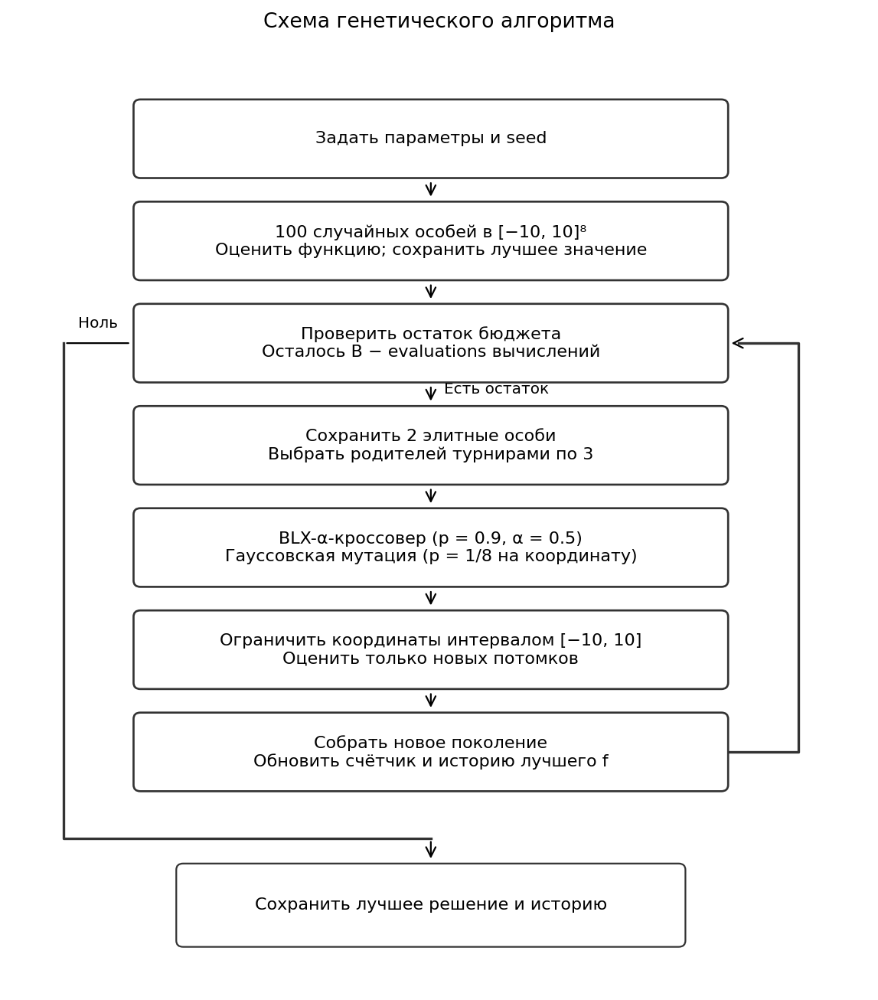
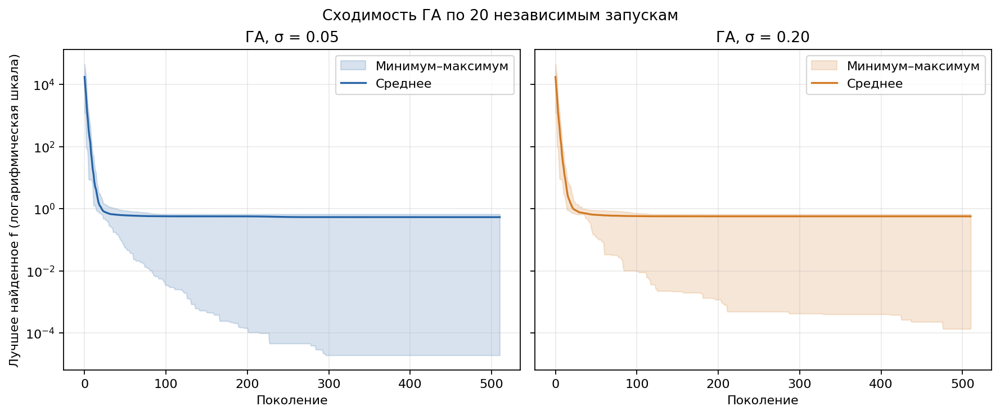
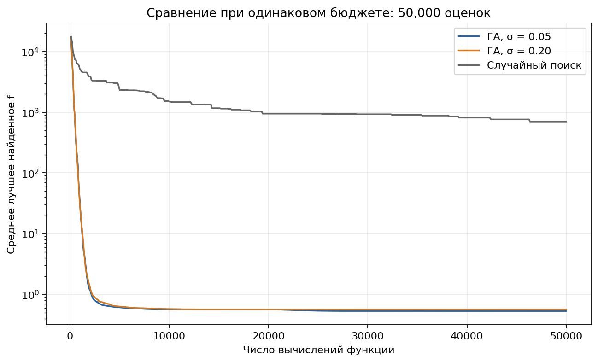
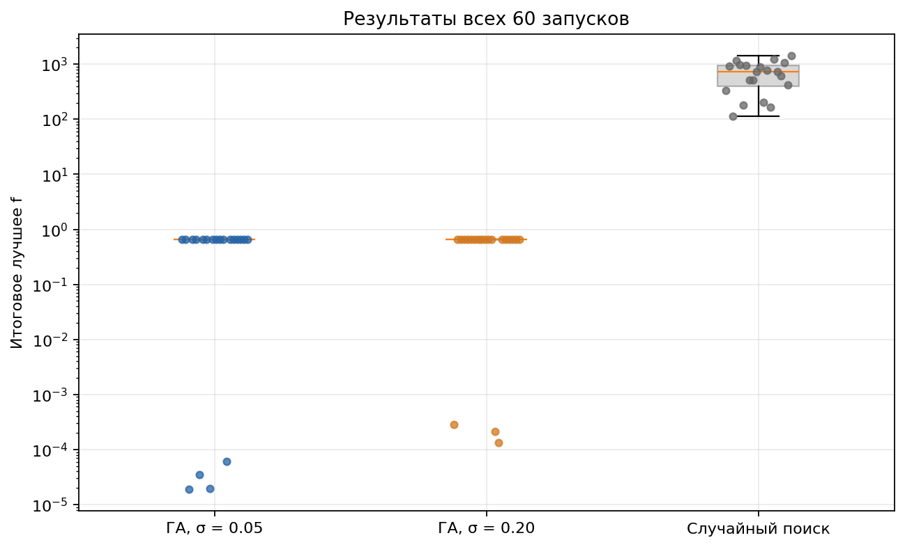

# Лабораторная работа 1

Многомерная оптимизация сложной функции генетическим алгоритмом

**Дисциплина:** Эволюционное программирование и генетические алгоритмы  
**Студент:** Демидович В. А.  
**Группа:** Б24-507  
**Вариант:** 9  
**Год:** 2026

## 1. Цель и постановка задачи

Цель работы — реализовать генетический алгоритм для непрерывной оптимизации
и проверить, как масштаб мутации влияет на результат. Для сравнения используется
случайный поиск с таким же числом вычислений целевой функции.

Порядковый номер в группе — 6. Для группы 507 индекс $Q=0$, год $Y=26$:

$$
V=1+((17\cdot6+7\cdot0+26)\bmod20)=9,
\qquad d=5+(9\bmod6)=8.
$$

По варианту требуется минимизировать функцию Диксона — Прайса:

$$
f(\mathbf{x})=(x_1-1)^2+\sum_{i=2}^{8}i(2x_i^2-x_{i-1})^2,
\qquad \mathbf{x}\in[-10,10]^8.
$$

Все слагаемые неотрицательны. Значение ноль достигается при $x_1=1$ и
$2x_i^2=x_{i-1}$. Один из глобальных минимумов можно записать как

$$
x_i^*=2^{-1+2^{1-i}},\quad i=1,\ldots,8,
\qquad f(\mathbf{x}^*)=0.
$$

Знак последней координаты можно поменять: её квадрат останется тем же.
Известный минимум используется только для проверки формулы и оценки качества.
В начальную популяцию он не добавляется и при поиске не используется.

## 2. Представление решения

Генотип — массив из восьми вещественных чисел. Фенотип — тот же вектор
аргументов функции, поэтому отдельное декодирование не требуется.
Единственные ограничения — границы каждой координаты.

В качестве оценки особи используется непосредственно $f(\mathbf{x})$:
меньшее значение считается лучшим. Преобразование функции для максимизации
не нужно, так как турнир сравнивает значения напрямую.

## 3. Генетический алгоритм

Начальная популяция равномерно генерируется в допустимой области. На каждом
поколении сохраняются две лучшие особи. Для остальных мест выбираются
родители и создаются новые потомки.

**Отбор.** Для одного родителя случайно выбираются три кандидата с возвращением.
Побеждает кандидат с наименьшим значением функции. Турнир удобен тем, что
не требует масштабировать фитнес и сохраняет вероятность выбора разных особей.
Увеличение размера турнира усилило бы давление отбора и риск потери разнообразия.

**Скрещивание.** Использован BLX-α с $\alpha=0.5$. Для координат родителей
$a_i$, $b_i$ вычисляется $\Delta_i=|a_i-b_i|$, затем координата потомка
равномерно выбирается из интервала

$$
[\min(a_i,b_i)-\alpha\Delta_i,\ \max(a_i,b_i)+\alpha\Delta_i].
$$

С вероятностью 0.9 используется скрещивание, иначе копируется первый родитель.
Каждый потомок создаётся из отдельно выбранной пары. Расширение интервала
позволяет исследовать точки за пределами отрезка между родителями. Этот
оператор также выполняет дополнительное задание методички.

**Мутация.** Каждая координата независимо изменяется с вероятностью $1/8$:

$$
x_i'=x_i+\varepsilon_i,\qquad \varepsilon_i\sim N(0,\sigma^2).
$$

В среднем получается одна мутировавшая координата на потомка. Масштаб $\sigma$
задан в единицах координат и остаётся постоянным в пределах одного запуска.

**Границы.** После скрещивания и мутации координаты ограничиваются операцией
$x_i\leftarrow\min(10,\max(-10,x_i))$. Поэтому каждое оцениваемое решение
допустимо. Такой способ прост, но может создавать скопления на границе.

**Элитизм и остановка.** Значения двух элитных особей переносятся без повторного
вычисления. За обычное поколение оцениваются 98 новых потомков. Остановка
происходит строго после 50 000 оценок, включая начальные 100.
После 509 полных обновлений остаётся бюджет на 18 потомков. На последнем
обновлении сохраняются 82 лучшие старые особи, поэтому размер популяции
остаётся 100 и бюджет не превышается. В истории есть поколения от 0 до 510.

## 4. План эксперимента

Сравнивались две конфигурации ГА, отличающиеся только масштабом мутации.

| Параметр | Конфигурация 1 | Конфигурация 2 |
|---|---:|---:|
| Размерность | 8 | 8 |
| Границы координат | [−10; 10] | [−10; 10] |
| Размер популяции | 100 | 100 |
| Элитные особи | 2 | 2 |
| Размер турнира | 3 | 3 |
| Вероятность скрещивания | 0.9 | 0.9 |
| α для BLX | 0.5 | 0.5 |
| Вероятность мутации координаты | 0.125 | 0.125 |
| σ | **0.05** | **0.20** |
| Бюджет оценок функции | 50 000 | 50 000 |
| Число запусков | 20 | 20 |

Случайный поиск проверяет 50 000 независимых равномерных точек из той же области
и сохраняет лучшую. Для него также выполнено 20 запусков. Итого проведено
60 запусков и 3 000 000 оценок функции. В каждом запуске создаётся новый
генератор `numpy.random.default_rng(seed)`; использованы seed от 0 до 19.
Список seed одинаков для всех методов, поэтому можно сравнивать результаты
при одинаковой начальной случайной выборке. Это не делает траектории методов
одинаковыми: после инициализации случайные числа расходуются по-разному.

В этой работе численным признаком близости к глобальному минимуму принят
порог $f<0.01$. Это выбранный критерий анализа, а не требование методички.
По достижении порога поиск не останавливается досрочно.

Сравнение проводится по числу оценок функции, а не по времени: у ГА есть
дополнительные затраты на отбор и создание потомков. Время сохранено в CSV
как вспомогательная характеристика и не является ограничением эксперимента.

## 5. Результаты

В таблице приведены итоговые лучшие значения каждого запуска. Стандартное
отклонение — выборочное, с делителем $n-1$. Полные значения без округления,
координаты и seed сохранены в `results/runs.csv`, сводка — в `results/summary.csv`.

| Метод | Лучшее | Среднее | Медиана | Ст. отклонение | Худшее | f < 0.01 |
|---|---:|---:|---:|---:|---:|---:|
| ГА, σ = 0.05 | 0.00001912 | 0.533342 | 0.666668 | 0.273581 | 0.666674 | 4/20 |
| ГА, σ = 0.20 | 0.00013474 | 0.566732 | 0.666689 | 0.244169 | 0.666750 | 3/20 |
| Случайный поиск | 114.894322 | 699.403228 | 728.926541 | 390.131814 | 1438.312492 | 0/20 |

Все конечные векторы допустимы. Среднее измеренное время одного запуска
составило примерно 0.034 с, 0.028 с и 0.008 с соответственно. Это короткие
замеры на конкретной машине; по ним нельзя делать вывод о скорости на других
системах. Окружение: Python 3.13.3, NumPy 2.4.2, macOS, ARM64.

Лучшее решение всей серии получено при $\sigma=0.05$, seed = 2:

$$
\mathbf{x}\approx(1.00056688,\ 0.70810396,\ 0.59509805,\ 0.54549035,
\ 0.52272769,\ 0.51125629,\ 0.50594783,\ 0.50295977),
$$

$$
f(\mathbf{x})\approx1.91159273\cdot10^{-5}.
$$

Значение функции рассчитано по полному вектору из CSV; здесь координаты округлены.
Для первой конфигурации порог достигнут на seed 2, 5, 8, 13, для второй —
на seed 0, 12, 13.

### Сходимость по поколениям

Линия — среднее лучшего найденного значения по 20 запускам. Закрашенная
область — минимум и максимум по серии, а не доверительный интервал.
Вертикальная шкала логарифмическая. Начальные популяции обеих конфигураций
совпадают для одинаковых seed. Сохранение элиты делает лучшую оценку каждого
запуска невозрастающей.

### Сравнение методов

У случайного поиска нет поколений, поэтому общее сравнение построено по числу
оценок функции. Контрольные точки бюджета совпадают с точками ГА, последняя
равна 50 000 для всех методов.

На диаграмме показаны все 20 результатов каждого метода. Коробка соответствует
интервалу от первого до третьего квартиля, линия в ней — медиане; усы задаются
стандартным правилом 1.5 межквартильного размаха. Отдельные точки показывают
все запуски, включая находящиеся за усами. Два скопления результатов ГА
объясняют, почему одной средней оценки недостаточно.

## 6. Анализ

При одинаковом бюджете обе настройки ГА дали намного меньшие значения функции,
чем случайный поиск. Но это ещё не означает устойчивого нахождения глобального
минимума: в 16 из 20 запусков первой настройки и 17 из 20 второй результат
остался около $2/3$. Например, точка $(1/3,0,\ldots,0)$ имеет значение $2/3$.
Это помогает интерпретировать наблюдаемую остановку поиска, хотя одно совпадение
значений не доказывает, что все конечные векторы совпали с этой точкой.

Меньший масштаб мутации дал в этой серии лучшее среднее, лучший отдельный
результат и на один успешный запуск больше. Он позволяет делать более мелкие
изменения около хорошей точки. Увеличение $\sigma$ до 0.20 не устранило
застревание. Разница 4/20 против 3/20 невелика: без более широкой серии и
статистической проверки нельзя утверждать, что первая настройка всегда лучше.

Функция неудобна для простого поиска из-за связей соседних координат:
слагаемое $i(2x_i^2-x_{i-1})^2$ зависит сразу от двух аргументов. Независимое
улучшение одного аргумента может нарушить уже найденное соотношение с другим.
Случайный поиск не использует найденные связи и должен случайно попасть
в небольшую область хороших восьмимерных решений. Локальный поиск может
столкнуться с областью стагнации; отдельный локальный метод в этой работе
не запускался, поэтому экспериментально сравнение с ним не проводилось.

Полученное лучшее решение хорошее по близости к известному минимуму: ошибка
по значению функции составляет примерно $1.9\cdot10^{-5}$. Однако алгоритм
в целом пока недостаточно надёжен для требования «почти всегда находить
глобальный минимум»: выбранный порог выполнен только в 20% и 15% запусков.
Практическое улучшение — проверить рестарты после стагнации или адаптивный
масштаб мутации при том же общем бюджете. В текущую реализацию эти механизмы
не включены, чтобы сравнивать базовый алгоритм по одному фактору.

## 7. Проверка корректности и выводы

Выполнено шесть автоматических проверок: известные значения функции,
аналитические минимумы, интервал BLX и отключение скрещивания, фактический
расход бюджета и допустимость всех оцениваемых точек, воспроизводимость,
отклонение некорректных настроек. В тесте бюджета проверяется число реально
переданных в функцию точек, а не только итоговый счётчик программы.

Реализован ГА с вещественным представлением и BLX-α-кроссовером. Он существенно
обошёл равномерную случайную выборку на заданной функции. Смена масштаба
мутации изменила результаты, но не решила проблему стагнации. Аналитически
обосновано значение глобального минимума; качество поиска и частота попадания
в его окрестность установлены экспериментально и не являются гарантией.

## Источник задания

Душкин Р. В. Дисциплина «Эволюционное программирование и генетические алгоритмы».
Комплекс лабораторных работ. Разделы 1.1–1.5 и лабораторная работа № 1.
Формула минимума в отчёте выведена непосредственно из суммы квадратов.
