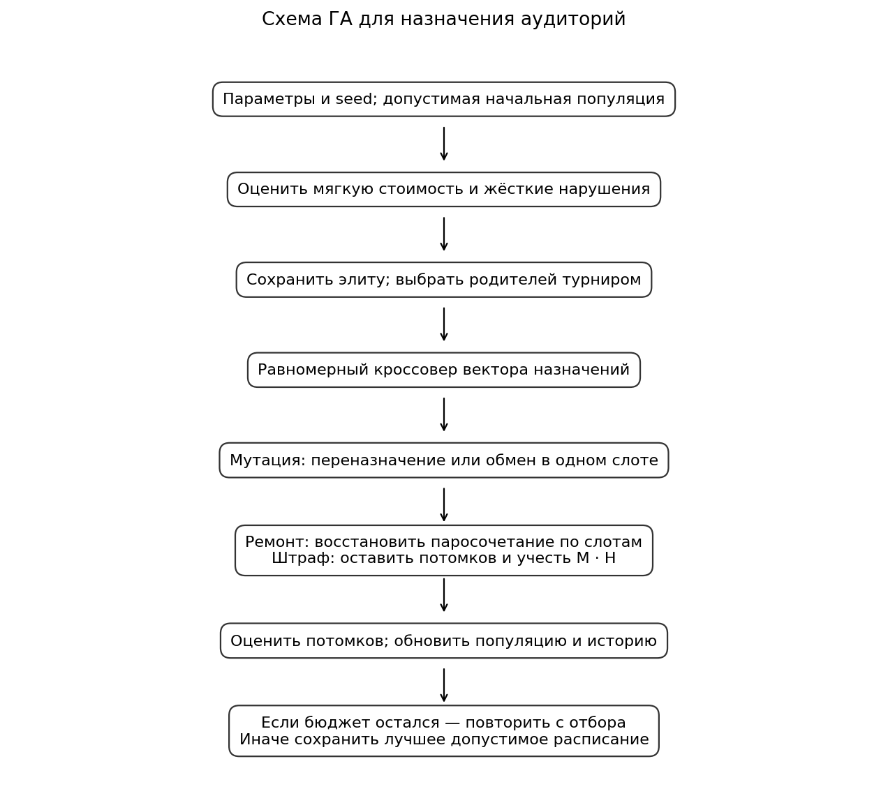
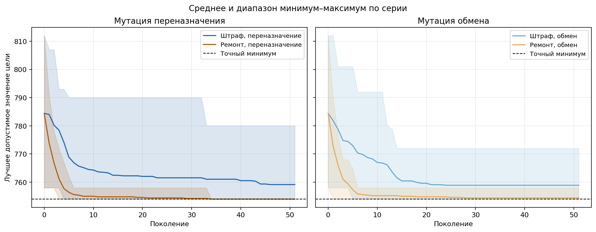
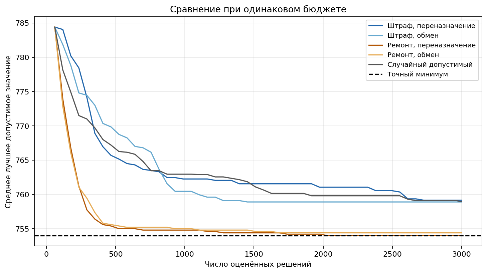
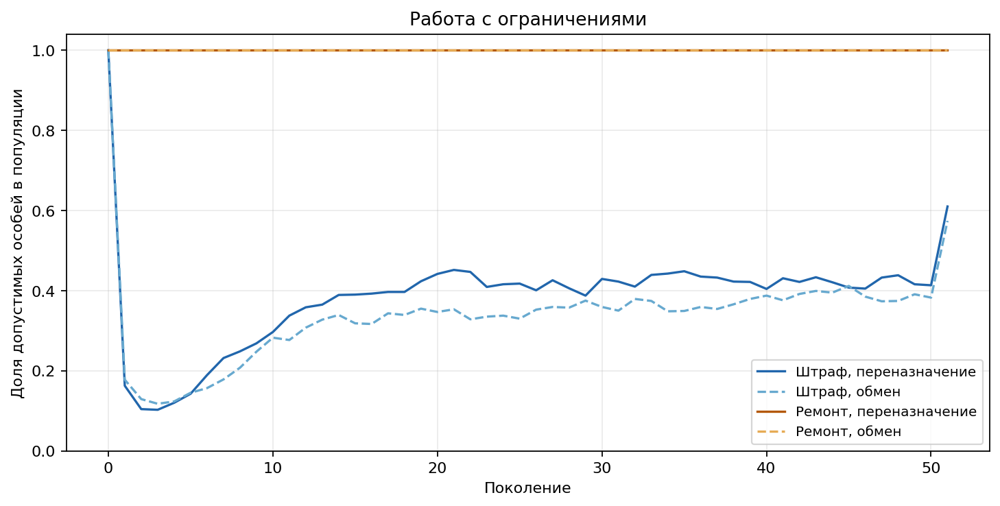
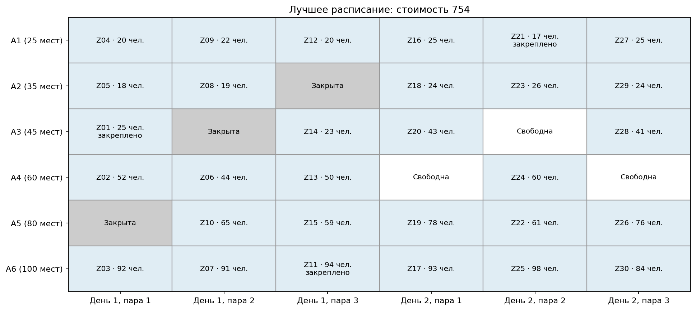

# Лабораторная работа 2

Генетический алгоритм для назначения аудиторий

**Дисциплина:** Эволюционное программирование и генетические алгоритмы  
**Студент:** Демидович В. А.  
**Группа:** Б24-507  
**Вариант:** 9  
**Год:** 2026

## 1. Цель и постановка

Цель работы — реализовать ГА для дискретной задачи с ограничениями и сравнить
способы получения допустимого решения. Для номера в группе $N=6$, индекса
группы $Q=0$ и года $Y=26$ номер варианта равен
$V=1+((17\cdot6+7\cdot0+26)\bmod20)=9$.

Вариант требует назначать аудитории занятиям с конфликтами по времени и
вместимости. В работе время занятий зафиксировано: алгоритм выбирает только
аудитории. Перенос занятий, преподаватели и состав учебных групп не моделируются.

Подготовлено 30 занятий и 6 аудиторий. В каждом из шести временных слотов
проходит по пять занятий. Получается 60 пар занятий с совпадающим временем:
$6\binom{5}{2}=60$. Вместимость аудиторий A1–A6: 25, 35, 45, 60, 80 и 100 мест.
В первых трёх слотах по одной аудитории недоступно. Три занятия закреплены
за конкретными аудиториями. Масштаб превышает минимальные требования задания
к назначениям и расписаниям.

### Входные данные

Данные синтетические, сохранены в `data.json`. Генератор использует
`numpy.random.default_rng(926)`. Для каждого слота сначала выбирается пять
разных доступных аудиторий. Численность занятия равномерно выбирается среди
целых от $\max(15,C_r-25)$ до $C_r$ включительно. Это гарантирует существование
допустимого назначения. Для первого занятия в слотах 0, 2, 4 сохраняется
закрепление. Для каждой пары «занятие — аудитория» генерируется целая стоимость
нежелательности от 0 до 40. Исходный гарантированно допустимый вектор в данные
не записывается и алгоритмам поиска не передаётся.

## 2. Математическая модель и представление

Особь — целочисленный вектор $\mathbf{x}=(x_1,\ldots,x_{30})$,
$x_i\in\{0,\ldots,5\}$. Координата непосредственно задаёт аудиторию занятия:
0 означает A1, 5 — A6. Фенотип — таблица «занятие, время, аудитория»;
декодирование сводится к подстановке названий по индексам. Непрерывное
кодирование не используется.

Пусть $t_i$ — слот, $s_i$ — число студентов, $C_r$ — вместимость аудитории,
$p_{ir}$ — стоимость нежелательности. Требуется минимизировать

$$
F(\mathbf{x})=\sum_{i=1}^{30}\left[\max(C_{x_i}-s_i,0)+p_{i,x_i}\right].
$$

На допустимом решении первое слагаемое — число свободных мест. Одно свободное
место и единица нежелательности имеют одинаковый вес, результат измеряется
в условных баллах. Максимум с нулём нужен для оценки недопустимых кандидатов;
дефицит мест не разрешается, а учитывается отдельным жёстким нарушением.

Жёсткие ограничения:

1. $C_{x_i}\ge s_i$ для каждого занятия.
2. При $t_i=t_j$ и $i\ne j$ должно выполняться $x_i\ne x_j$.
3. Аудитория должна быть доступна в соответствующем слоте.
4. Закреплённое занятие должно остаться в назначенной аудитории.

Число нарушений $H$ — сумма числа переполненных назначений, назначений в
закрытые аудитории, нарушенных закреплений и конфликтующих пар. Одно решение
может нарушать несколько условий одновременно. Все ограничения проверяются
при оценивании, независимо от выбранного способа их обработки.

### Примеры решений

Ниже приведены полные векторы в порядке Z01–Z30; вертикальные черты отделяют
временные слоты по пять занятий.

Пример 1:

```text
2 3 5 1 0 | 3 5 0 1 4 | 5 2 3 0 4 | 3 5 0 4 2 | 0 4 2 3 5 | 4 0 2 3 5
```

Пример 2:

```text
2 3 5 1 0 | 3 5 1 0 4 | 5 0 4 2 3 | 1 5 3 4 2 | 0 4 1 3 5 | 4 3 2 1 5
```

Пример 3:

```text
2 2 5 1 0 | 3 5 0 1 4 | 5 2 3 0 4 | 3 5 0 4 2 | 0 4 2 3 5 | 4 0 2 3 5
```

Пример 4:

```text
2 3 5 1 0 | 3 5 0 1 4 | 5 2 3 0 4 | 3 1 0 4 2 | 0 4 2 3 5 | 4 0 2 3 5
```

| Пример | Вместимость | Закрытая аудитория | Закрепление | Конфликт пар |
|---|---:|---:|---:|---:|
| 1 | 0 | 0 | 0 | 0 |
| 2 | 0 | 0 | 0 | 0 |
| 3 | 1 | 0 | 0 | 1 |
| 4 | 1 | 0 | 0 | 0 |

Первые два решения допустимы. Третий пример назначает Z01 и Z02 в одну
аудиторию; дополнительно она мала для Z02. Четвёртый использует свободную,
но недостаточно вместительную аудиторию, поэтому нарушает только вместимость.
Машиночитаемые версии находятся в `results/examples.json`.

## 3. Алгоритм и работа с ограничениями

Начальные 60 особей генерируются случайно и восстанавливаются до допустимости.
Для одинакового seed начальные популяции всех четырёх ГА совпадают. Родители
выбираются турнирами по три особи, две лучшие особи сохраняются без изменений.

**Кроссовер.** С вероятностью 0.9 применяется равномерный кроссовер: для каждой
координаты с равными вероятностями берётся аудитория одного из родителей.
Индекс остаётся корректным, но одновременные занятия могут получить одну
аудиторию. Поэтому одной корректности диапазона генов недостаточно.

**Переназначение.** Каждая координата выбирается с вероятностью $1/30$.
Если есть альтернатива, аудитория меняется на случайную другую из подходящих
по вместимости, доступности и закреплению. Это примерно одна попытка изменения
на потомка. Занятость другими занятиями не проверяется внутри мутации:
конфликты обрабатываются общим штрафом или ремонтом.

**Обмен.** С вероятностью 0.5 выбираются два разных занятия одного временного
слота и обмениваются аудиториями. Это специализированный оператор для
представления назначений: он сохраняет набор используемых в слоте аудиторий.
На допустимом родителе не создаёт комнатных конфликтов, но может нарушить
вместимость или закрепление. В среднем затрагивается одна координата на
потомка: два гена при вероятности 0.5. У неизменяемых назначений и совпадающих
значений фактическое число изменений может быть меньше.

**Штраф.** Оценка для отбора равна $S=F+M H$, где

$$
M=1+\sum_i\max_r\{\max(C_r-s_i,0)+p_{ir}\}=2252.
$$

Это значение больше верхней границы мягкой стоимости любого решения.
Поэтому любое допустимое решение лучше любого недопустимого, а среди
допустимых минимизируется исходная цель. Потомки не ремонтируются; в популяции
могут оставаться нарушающие ограничения особи. Допустимая элита гарантирует,
что итоговый лучший вектор допустим.

**Ремонт.** После мутации отдельно для каждого слота строится паросочетание
между занятиями и подходящими аудиториями. Сначала рассматриваются занятия
с меньшим числом вариантов. Унаследованная аудитория проверяется первой,
остальные перемешиваются. Если аудитория занята, рекурсивный поиск увеличивающей
цепи пытается перенести её владельца. Так можно исправить конфликт, который
обычный жадный проход не смог бы исправить. При невозможности полного
паросочетания программа сообщает об ошибке. Мягкая стоимость в ремонте не
используется: он восстанавливает допустимость, а не находит оптимальное расписание.
Уже допустимый вектор остаётся неизменным.



## 4. Эксперимент

Проведён эксперимент $2\times2$: штраф/ремонт и переназначение/обмен.
Сравнивая способы ограничений, фиксируем мутацию; сравнивая мутации,
фиксируем способ ограничений. Остальные параметры одинаковы.

| Параметр | Значение |
|---|---:|
| Популяция | 60 |
| Элита | 2 |
| Размер турнира | 3 |
| Вероятность кроссовера | 0.9 |
| Вероятность переназначения координаты | 1/30 |
| Вероятность обмена на потомка | 0.5 |
| Бюджет одного запуска | 3000 оценённых решений |
| Seed | 0–19 |
| Запусков каждого метода | 20 |

Базовый метод — случайный допустимый поиск. Для каждой попытки генерируется
случайный вектор, затем применяется тот же ремонт. Сохраняется лучший из
3000 допустимых кандидатов. Распределение не является равномерным по всем
допустимым расписаниям: процедура восстановления создаёт собственное смещение.
Метод не использует отбор, скрещивание и накопление популяции.

Всего выполнено 100 запусков, 300 000 оценок решений. В бюджет входят
начальные 60. За обычное поколение оценивается 58 потомков; после 50 полных
поколений остаётся место для 40 потомков. На последнем шаге сохраняются
20 лучших старых особей. В истории есть поколения 0–51. Расчёт стоимости
и всех нарушений одного вектора считается одной оценкой, даже при пакетном
вызове Python-функции. Элита повторно не оценивается.

Ремонт не входит в счётчик оценок: это дополнительная алгоритмическая работа.
Поэтому отдельно сохранены время и число вызовов ремонта. У штрафного ГА
60 ремонтов на инициализации, у ремонтного ГА и случайного метода — 3000
за запуск. Сравнение по бюджету оценок не означает равенства времени работы.

### Точный ориентир качества

Для данного небольшого экземпляра можно решить каждый слот точно динамикой
по маске занятых аудиторий. Состояние хранит лучшую стоимость назначения
первых $k$ занятий при данном наборе занятых комнат. Переход добавляет одну
подходящую свободную аудиторию. Слоты независимы, поэтому их минимумы
складываются. Получен точный минимум **754**. Расчёт эталона выполняется
после серии и не включён в бюджет поисковых методов. Он нужен только для
оценки качества и не участвует в создании особей.

## 5. Результаты

В таблице — стоимость лучшего допустимого решения каждого запуска.
Стандартное отклонение выборочное, с делителем $n-1$.

| Метод | Лучшее | Среднее | Медиана | Ст. отклонение | Худшее | Попаданий в 754 |
|---|---:|---:|---:|---:|---:|---:|
| Штраф + переназначение | 754 | 759.15 | 756.0 | 7.436 | 780 | 10/20 |
| Штраф + обмен | 754 | 758.90 | 758.0 | 5.590 | 772 | 7/20 |
| Ремонт + переназначение | 754 | 754.00 | 754.0 | 0.000 | 754 | 20/20 |
| Ремонт + обмен | 754 | 754.40 | 754.0 | 1.231 | 758 | 18/20 |
| Случайный допустимый поиск | 754 | 758.95 | 758.0 | 3.236 | 765 | 3/20 |

Все 100 итоговых решений допустимы. Полные векторы и статистика сохранены
в `results/runs.csv` и `results/summary.csv`.

| Метод | Среднее время запуска, с |
|---|---:|
| Штраф + переназначение | 0.0428 |
| Штраф + обмен | 0.0366 |
| Ремонт + переназначение | 0.2353 |
| Ремонт + обмен | 0.2301 |
| Случайный допустимый поиск | 0.2359 |

Это короткие замеры на Python 3.13.3, NumPy 2.4.2, macOS ARM64.
Их следует считать характеристикой конкретной серии, а не точным сравнением
производительности на разных машинах.



Линии показывают среднее лучшего допустимого значения, заливка — диапазон
от минимума до максимума по 20 запускам, не доверительный интервал.



Общее сравнение использует число оценённых решений: у случайного метода нет
поколений. Начальная выборка и контрольные точки бюджета совпадают с ГА.



У ремонта доля допустимых особей равна единице. У штрафа она заметно ниже,
особенно после первого скрещивания. Подъём на последнем шаге частично связан
с неполным поколением: в нём сохраняется больше старых хороших особей.

### Лучшее расписание

Стоимость 754, разрыв с точным оптимумом 0%. Первое такое решение в порядке
запуска методов получено у штрафа с переназначением, seed 1; такой же минимум
находят и другие конфигурации. Все 30 назначений представлены на рисунке
и в `results/best_schedule.csv`, включая вместимость и компоненты стоимости.



## 6. Обсуждение и выводы

Лучший результат по устойчивости в этой серии дал ремонт с переназначением:
точный оптимум получен 20 раз из 20. Ремонт с обменом нашёл его 18 раз.
Таким образом, восстановление ограничений оказалось полезнее чистого штрафа
при обеих мутациях. Оно делает каждую следующую оценку оценкой допустимого
кандидата, но требует дополнительного времени.

При ремонте переназначение получило среднее 754 против 754.4 у обмена.
Для штрафа среднее чуть меньше у обмена — 758.9 против 759.15, но у
переназначения больше попаданий в оптимум — 10 против 7. Поэтому вывод
«одна мутация всегда лучше» из этой серии не следует. Статистическая
значимость небольших различий отдельно не проверялась.

Случайный допустимый поиск оказался достаточно сильной базой: среднее 758.95,
три точных попадания. Штрафные ГА не показали убедительного преимущества
перед ним по среднему. Ремонтные конфигурации дали более устойчивое качество,
но в этом помогает и сама процедура восстановления, которая используется
вместе с эволюционными операторами. Нельзя приписывать результат только отбору.

Для этого экземпляра найденное решение является хорошим: оно соблюдает все
ограничения и совпадает с независимым точным минимумом. Случайные методы не
обладают гарантией оптимальности; гарантия качества конкретного расписания
получена благодаря точному эталону. Частота 20/20 относится только к данным
и seed этой работы.

Задача специально ограничена фиксированными слотами и шестью аудиториями,
поэтому точный метод здесь вполне уместен и для практического использования
может быть предпочтительнее ГА. Работа нужна для изучения дискретного кодирования,
мутаций и ограничений, а не для доказательства превосходства эволюционного
подхода над точными алгоритмами. Для расширения модели можно добавить
выбор времени, оборудование, переходы между корпусами и конфликты преподавателей;
текущий покомпонентный ремонт тогда потребуется пересмотреть.

## 7. Проверка корректности

Семь автоматических проверок охватывают отдельные ограничения, допустимость
после ремонта, неизменность допустимого вектора при ремонте, точную динамику
в сравнении с перебором по слотам, бюджет на границах 30, 31 и 103 оценки,
сохранение элиты, воспроизводимость и свойства мутаций. Также проверяется
обнаружение данных, для которых полного назначения не существует.
Расход бюджета проверяется подсчётом реально оценённых векторов.

## Источник задания

Душкин Р. В. Дисциплина «Эволюционное программирование и генетические алгоритмы».
Комплекс лабораторных работ. Общие требования и лабораторная работа № 2,
вариант 9. Входные данные синтетические, процедура генерации описана выше.
